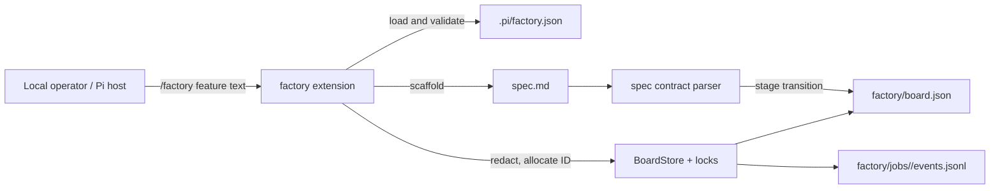
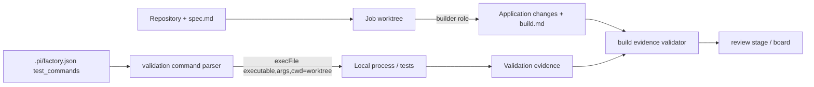
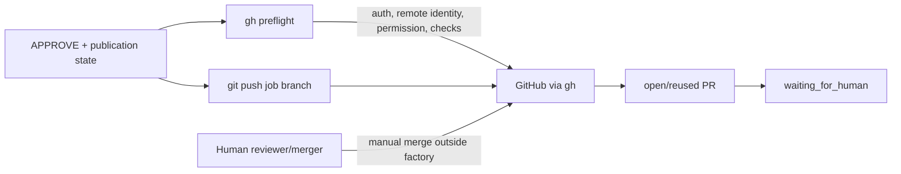
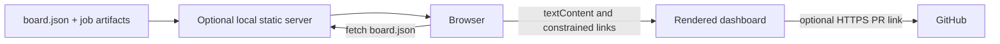
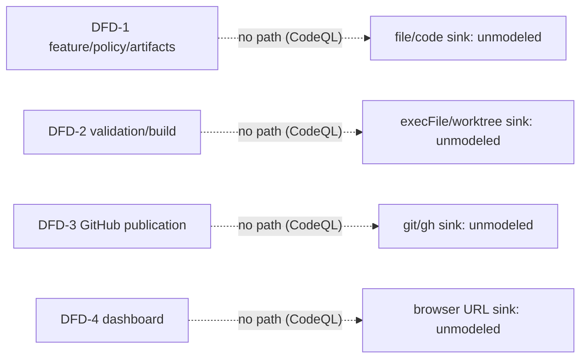
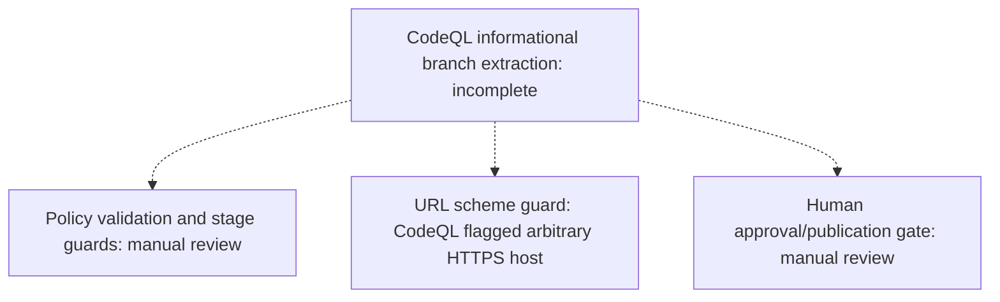

# Phase L2 Knowledge Base / Threat Model

Repository: `arest/pi-agent-fabric` at commit `7491206657accbfa06cbf56e5b4ee453ee28620b` (`main`). Evidence is from the source tree, README/ADR/skill documentation, and the Phase L1 advisory summary. No curated `KNOWLEDGE-BASE.md` or legacy `INFO.md` was present.

## Project Type & Components

**Classification:** local Node.js/TypeScript Pi extension and package; workflow orchestrator, filesystem-backed state machine, Git/GitHub integration, and read-only static dashboard. It is not an inbound HTTP API, daemon, datastore-backed service, or worker with a network listener.

**Runtime components**

- `extensions/factory.ts`: Pi host command adapter for `/factory`; dispatches feature creation, spec, recovery, and operator transitions. It relies on the Pi host to establish the execution context and operator identity.
- `src/workflow/*`: spec, build, review, approval, publication, recovery, and operator state transitions.
- `src/state/*`: `factory/board.json`, per-job artifacts/events, worktrees, and cross-process lock files. `BoardStore` performs locked atomic writes and schema validation.
- `src/artifacts/*`: Markdown/JSON evidence contracts for specs, build evidence, reviews, and decisions.
- `src/config/policy.ts`: repository-controlled `.pi/factory.json` policy parser. It fail-closes unsupported target/merge modes and rejects shell metacharacters in configured validation commands.
- `src/workflow/gh.ts` and GitHub adapters: fixed-argument `execFile` calls to local `git` and `gh`; GitHub authentication and permissions are delegated to the local `gh` credential/context.
- `factory/dashboard.html`: static, read-only polling UI. If served by a local static server, it fetches `board.json` and artifact links; it is not an application route.

**External/runtime dependencies:** Node >=24; optional peer `@earendil-works/pi-coding-agent` (development lock resolves 1.1.0, but published peer range is unrestricted `*`); local `git`; local `gh`; GitHub repository/PR/check APIs. L1 found no Docker, CI workflow, database, or vendored source. The host package is a material trust dependency: project-local resources/extensions and host loading behavior are outside this repository.

**Security decisions:** policy validation and target/merge invariants (`src/config/policy.ts`); job/stage eligibility checks in workflow modules; artifact contract validation; command allowlisting in `src/workflow/gh.ts`; repository identity and GitHub permission preflight; board locks/version checks; dashboard URL and DOM rendering policy; human approval/merge gates.

## Attack Surface

- **Local command input:** `/factory` feature text, subcommands, job IDs, operator notes, and the host-provided `cwd`.
- **Repository-controlled inputs:** `.pi/factory.json`; source/build/test code; Git branches/remotes; Markdown/JSON job artifacts; reviewer and approver reports; filenames and symlink topology.
- **Process boundary:** configured validation commands, local `git`, local `gh`, inherited `PATH`/environment, worktree cwd, and process output.
- **Filesystem boundary:** board, event log, locks, job artifacts, review rounds, and worktrees under `factory/`.
- **GitHub boundary:** authenticated `gh` context, remote identity, branch refs, permissions, checks, PR lookup/create responses, and push operations.
- **Browser/static boundary:** `board.json`, artifact links, PR URLs, and any server chosen to expose the dashboard directory.
- **Not present:** inbound HTTP API, WebSocket, GraphQL endpoint, upload handler, database, proxy middleware, tenant routing, or server-side session/auth implementation.

## Key Dependencies

| Component | Version/evidence | Security relevance / reachability |
|---|---|---|
| `@earendil-works/pi-coding-agent` | optional peer `*`; dev/lock `1.1.0` | High: host extension API, command registration, project-local resource loading, and host trust model. L1 advisories cover related versions; consumer runtime is unresolved. |
| Node.js | `>=24` in `package.json` | High: native TypeScript runtime, filesystem, child process, path, crypto, and environment semantics. |
| `git` | local executable, `src/workflow/build-stage.ts`, `gh.ts` | High: worktree/branch creation, ref resolution, push, remote identity. |
| GitHub CLI `gh` | local executable, `src/workflow/gh.ts` and adapters | High: credentials, repository identity, permissions, checks, PR publication/promotion. |
| TypeScript | `5.9.3` dev dependency | Medium: build/typecheck toolchain; generated/transpiled extension behavior must match host assumptions. |
| Browser/static server | deployment-provided; `factory/dashboard.html` | Conditional: exposes board/artifacts if mapped without server-side access control; no server implementation is included. |

## Trust Boundaries

| Boundary | Data/control crossing it | Security assumptions and controls |
|---|---|---|
| Pi host/operator -> extension | `/factory` text, job IDs, notes, current `cwd`, host-loaded package code | Pi host is trusted to load the intended extension and identify the human operator. The extension has no independent user authentication or authorization. Feature text/notes are treated as untrusted and secret-redacted/bounded. |
| Consumer repository -> factory | `.pi/factory.json`, repository files, Git metadata, feature/spec/build/review/decision artifacts | Repository content can be attacker-controlled when the factory runs in an untrusted checkout. Policy has strict schema, fixed develop target, human merge requirement, safe relative paths, and command metacharacter rejection. Artifact prose is validated for shape, not truth. |
| Artifacts/board -> parsers and workflow | JSON, Markdown headings, role names, job IDs, URLs, review findings | Parsers are contract/shape validators; board writes use locks, atomic replacement, and schema parsing. Content can still influence later role prompts, dashboard display, and workflow decisions. |
| Factory -> local process execution | `git`, `gh`, configured validation executable plus argv and cwd | `execFile` avoids shell interpretation for GitHub adapter calls. Validation commands are token-split and policy-filtered, but the executable and arguments remain repository policy-controlled and execute with factory privileges. Local `git`/`gh` binaries and environment are trusted assumptions. |
| Factory -> filesystem/worktrees | Paths derived from repository root, job ID, artifact writes, lock files, worktree creation | Job IDs are allocated/validated and paths are rooted under `factory`; locks serialize shared operations; atomic board writes preserve consistency. Filesystem permissions, symlink behavior, malicious pre-existing trees, and concurrent local users remain deployment assumptions. |
| Factory -> GitHub | Git push, PR creation/list/view, GraphQL viewer permission and checks | `gh auth status`, remote-vs-`gh` repository identity, permission checks, no force push, no branch deletion, no auto-merge, and human merge are controls. `gh` credentials and repository authorization are external trust anchors. |
| Dashboard/static server -> browser | `board.json` and artifact/PR URLs | Dashboard is read-only and uses `textContent`, CSP, HTTPS-only external links, and local path restrictions. A server exposing `factory/` without access control would expose workflow metadata/artifacts to any reachable reader. |

## Data-Flow Slices (DFD)

### DFD-1: Feature request to durable job state

Primary risks: feature/notes are untrusted content; repository policy is a control input; board integrity and path confinement are relied upon for durable state.

### DFD-2: Repository artifact to builder and validation execution

Primary risk is repository-controlled or policy-controlled code executing with the local user's privileges. Shell syntax is rejected, but command allowlisting, executable resolution, resource limits, environment inheritance, and symlink/worktree integrity require later verification.

### DFD-3: Approved branch to GitHub PR

Primary risks: credential/context confusion, repository identity mismatch, branch/ref confusion, PR adoption, and external API responses. Human merge is an explicit containment boundary.

### DFD-4: Board/artifacts to static dashboard

No inbound application route is implemented in this repository. Exposure depends entirely on how a consumer serves the static directory.

## Control-Flow Slices (CFD)

### CFD-1: State-machine authorization and human gates

`/factory` dispatches to a command-specific workflow. Each transition first checks the job, then re-checks eligibility inside `BoardStore.mutate` under the board lock. `spec -> build` requires required Markdown sections; build requires valid evidence and passing configured validation; review requires all selected reports; approval requires a distinct decision; publication requires `APPROVE`; operator approval/rework/promote/cancel are stage/status guarded. Publication and promotion stop at `waiting_for_human`; the factory never merges or changes branch protection. The effective authorization principal is the Pi operator/host, not a token checked by this package.

### CFD-2: Build/rework/recovery orchestration

`build` acquires a per-job branch lock, prepares a Git worktree, then holds a worktree builder lock while invoking the builder and validation. Failures become `blocked` or `needs-human`; rework retains prior evidence before opening a numbered round. Recovery reconciles board state with artifacts, Git, and GitHub and should escalate disagreements rather than guessing. Locks and idempotent event keys are hidden control channels affecting whether execution proceeds.

### CFD-3: Publication/promotion controls

Publication checks policy target, runs `gh auth status`, verifies `remote.origin.url` equals `gh repo view`, checks viewer permission (`ADMIN|MAINTAIN|WRITE`), reads check runs, pushes only the job branch, and creates/reuses a PR to `develop`. Promotion accepts only `main|master`, verifies human-merge/no-auto-merge policy, scopes PR lookup by head/base, and never merges. The local `gh` config/token, Git remote, branch refs, and API response are security-relevant control inputs.

## Framework Contracts and Hidden Control Channels

- **Pi extension contract:** `ExtensionAPI.registerCommand` makes `/factory` available to any actor able to drive the loaded Pi session. `ExtensionCommandContext.cwd` is the repository root and is security-critical; no independent authn/authz, tenant binding, CSRF, or role check exists in this package.
- **Host/package loading:** the optional peer range is `*`. The Pi host resolves and loads extensions/skills and may load project-local resources. L1 advisories affect this boundary (notably untrusted repository extension loading and predictable temporary install paths). Consumer host version/trust decisions can change behavior before `factory.ts` runs.
- **Runtime mode:** Node-only assumptions include `node:fs/promises`, `node:child_process`, `node:path`, and native TypeScript execution. No edge/serverless/browser runtime is supported. Environment variables, `PATH`, `HOME`, Git config, and `gh` config/token affect subprocess identity and binary resolution.
- **Filesystem/path contract:** all paths are resolved from `cwd` into `factory/`; job IDs are used in directories, locks, and branch names. Existing symlinks, permissions, shared users, and a mutable checkout can alter the intended boundary. `factory/dashboard.html` assumes a server maps its directory to `board.json` and artifact paths without adding auth.
- **Policy control channel:** `.pi/factory.json` selects validation commands, required files, reviewers, limits, and GitHub settings. It is repository-controlled but parsed fail-closed; target is fixed to `develop`, auto-merge is forbidden, and shell metacharacters are rejected. Validation command tokenization is not a shell, but command names/arguments still select local programs and inherit environment.
- **Subprocess contract:** `execFile` is used without a shell for Git/gh and validation. The code trusts executable lookup, local binary integrity, inherited environment, output size (4 MiB), command completion, and Git worktree cwd. `gh` output is parsed as JSON for identity, permissions, PRs, and checks.
- **GitHub/remote assumptions:** only canonical `git@github.com:` and `https://github.com/` remotes parse; `gh repo view` is authoritative for the authenticated repository. `gh auth status` and viewer permissions are not a per-command operator identity mechanism. Branch names and PR state returned by GitHub influence durable transitions.
- **HTTP/header/cache inventory:** this repository defines no HTTP server, middleware, reverse proxy, route matcher, tenant selector, auth header parser, method/path override, preview/debug/admin header, CDN/cache key, `Host`, `Forwarded`, `X-Forwarded-*`, `X-Real-IP`, or original URL/method handling. The only browser HTTP contract is dashboard `fetch('board.json?ts=...')`; cache behavior is requested as `no-store`, and the timestamp is a cache-busting query rather than an auth/control signal.
- **Dashboard browser contract:** CSP is `default-src 'none'`, with inline script/style and same-origin connect; DOM insertion uses `textContent`; external links require clean absolute HTTPS URLs; local links must start `jobs/` and contain no `..`. This is a client-side control only and must not substitute for server-side access control.
- **Markdown contracts:** spec/build/review/decision parsers validate headings/markers and largely do not semantically validate prose. Markdown is later consumed by roles and rendered/served as artifacts, so prompt injection, content confusion, and unsafe downstream renderers remain relevant.

## Threat Model

**Assets:** GitHub credentials and repository integrity; source code and protected branches; local filesystem/worktrees; factory board/history and review evidence; feature/spec/review contents; build/test compute; operator decisions; PR and approval metadata.

**Threat actors/capabilities:** (1) malicious or compromised repository contributor controlling checkout files, policy, artifacts, and build code; (2) another local user/process able to alter the checkout, factory files, PATH, Git/gh state, or predictable temporary paths; (3) malicious feature/spec/review content intended to steer roles or poison evidence; (4) compromised GitHub account/repository or misleading external API state; (5) anonymous browser user only if a consumer exposes the static dashboard/artifacts. Not assumed: arbitrary remote network access to a factory API, because no network listener exists; bypass of OS permissions; or automatic merge authority.

| Abuse path | Assets/boundary | Likelihood | Impact | Priority | Existing controls / conditional mitigation |
|---|---|---:|---:|---:|---|
| Untrusted repository policy/build input selects a privileged executable or malicious project code during validation | Repository -> subprocess | Medium | High | High | `execFile`, shell metacharacter rejection, worktree lock. Add explicit executable allowlist, scrub environment, resource/time limits, and require trusted-repository confirmation before execution. |
| Project-local Pi resources or a vulnerable/incompatible host load attacker-controlled extension code | Repository -> Pi host | Medium (untrusted checkout) | High | High | Host boundary is documented; optional peer is unrestricted. Pin a supported/fixed host baseline and require explicit trust confirmation before project-local loading. |
| Local race/symlink/path manipulation changes artifacts, locks, worktree, or board target | Local user/process -> filesystem | Medium | High | High | Rooted paths, job ID validation, locks, atomic board writes. Validate ownership/no symlink at sensitive roots, use restrictive permissions, and test hostile pre-existing paths. |
| Credential/repository confusion causes push or PR publication to an unintended repository/branch | Factory -> GitHub | Low/Medium | High | High | remote-vs-`gh` identity and permission preflight, fixed target, no force push/merge. Bind all later calls to verified immutable repo/ref identity and re-check before mutation. |
| Artifact prompt/content injection causes a role or reviewer to approve unsafe changes | Artifact parser -> role/control flow | Medium | High | High | Separate contract validation and independent approval. Treat artifacts as untrusted data, constrain role prompts, and require machine-verifiable changed-file/policy evidence. |
| Static dashboard/artifacts are served without access controls and disclose features, notes, source paths, or PR metadata | Static server -> browser | Conditional | Medium | Medium | Read-only UI/CSP/escaping. Keep factory directory private or add server-side authorization; do not rely on dashboard JavaScript restrictions. |
| Oversized/hostile feature, artifact, test output, or job volume causes disk/CPU/board growth denial of service | Inputs -> filesystem/process | Medium | Medium | Medium | Operator note bound, output buffer bound, locks. Add feature/artifact/output/job quotas and subprocess timeout/resource controls. |

Threat rankings assume the package is used in a developer checkout and may process untrusted branches. If only trusted local repositories are used, repository-origin threats reduce; if shared CI or internet-served dashboards are used, they increase materially.

## Domain Attack Modes

Identified domains: local extension/plugin loading; command/process execution; filesystem/path and race safety; Git/GitHub API and credential context; Markdown/HTML/browser rendering; durable JSON state/concurrency.

### Domain: local extension/plugin loading

**Identified via:** Pi extension manifest, optional host peer, `extensions/factory.ts`, L1 advisories GHSA-mqxh-6gq7-558m and GHSA-jfgx-wxx8-mp94.

**Known attack classes:** project-local code execution/trust confusion; vulnerable host API compatibility; predictable temporary install/path collision; resource loading from attacker checkout.

| Attack | Description | Detection strategy | Relevance |
|---|---|---|---|
| Untrusted project resource loading | Host loads code/resources from a repository before operator trust decision | Review host loader configuration and install paths; execute from hostile checkout | High |
| Host version drift | `*` peer permits behavior/security contract changes | Resolve consumer host versions and enforce minimum/fixed security baseline | High |
| Temporary path collision | Shared local path lets another user influence loaded package | Inspect host install/temp directory permissions and randomness | Medium |

**Custom SAST targets:** extension/resource imports crossing repository roots; unrestricted peer version; filesystem temp/install paths without exclusive creation; command registration lacking host trust gate. Priority High.

**Manual review checklist:**
- [ ] Confirm Pi does not load project-local extensions/skills without explicit trust.
- [ ] Verify consumer host version is outside all affected advisory ranges.
- [ ] Verify npm/git install and temp paths are private, random, and atomically created.
- [ ] Verify the extension cannot be invoked under a different repository `cwd` than intended.

**Research sources used:** security-threat-model methodology; L1 advisory summary/OSV findings; domain playbook signals; web-search backend unavailable in this run.

### Domain: command/process execution

**Identified via:** `node:child_process`, `execFile`, configured `test_commands`, Git and `gh` adapters.

**Known attack classes:** command injection/argument injection; PATH binary substitution; malicious build/test code; environment/credential leakage; resource exhaustion.

| Attack | Description | Detection strategy | Relevance |
|---|---|---|---|
| Executable or argument injection | Repository policy selects a dangerous executable/argument despite no shell | Trace policy values to `execFile`; test whitespace, flags, absolute paths, and PATH changes | High |
| Build-code execution | Tests/build run arbitrary project code with operator privileges | Model all validation commands and inherited env/cwd | High |
| PATH/env substitution | Local attacker replaces `git`, `gh`, or test binary or injects credentials | Resolve binaries, inspect env allowlist and permissions | High |
| Output/resource DoS | Child process consumes CPU, memory, disk, or 4 MiB output | Check timeout, max output, process-group termination, quotas | Medium |

**Custom SAST targets:** EnvironmentVariable/LocalUserInput -> `execFile` executable/args; `policy.repository.test_commands` -> process execution; missing timeout/env/cwd restrictions. Priority High.

**Manual review checklist:**
- [ ] Allowlist validation task names/executables rather than accepting arbitrary policy commands.
- [ ] Use absolute trusted executable paths and a scrubbed environment for GitHub operations.
- [ ] Enforce timeout, output, CPU, memory, and process-tree cleanup.
- [ ] Confirm secrets cannot enter build output, board history, or error strings.

**Research sources used:** security-threat-model methodology; Node child-process security guidance topic; domain playbook; web-search backend unavailable in this run.

### Domain: filesystem/path, JSON state, and concurrency

**Identified via:** `src/state/paths.ts`, `board-store.ts`, `lock.ts`, atomic writes, worktrees, job IDs.

**Known attack classes:** traversal; symlink substitution; TOCTOU/race; lock spoofing; corrupted/replayed state; disk exhaustion.

| Attack | Description | Detection strategy | Relevance |
|---|---|---|---|
| Symlink/path escape | Pre-created job/worktree or artifact path redirects writes | Run with symlinked factory/jobs/worktree components and inspect realpath/ownership checks | High |
| Lock spoofing/DoS | Attacker creates lock or stale owner metadata to block transitions | Review lock acquisition semantics, permissions, stale-lock recovery | High |
| State confusion | Board and event/artifact evidence disagree or replay transitions | Fuzz board/events and exercise crash points/recovery | High |
| Resource exhaustion | Unbounded jobs/artifacts/history fill disk or board | Test quotas and size limits | Medium |

**Custom SAST targets:** job ID/user input -> `path.join` and filesystem writes; file reads without `lstat/realpath`; board JSON -> state transition; lock creation and stale-lock cleanup. Priority High.

**Manual review checklist:**
- [ ] Reject symlinks and verify ownership/permissions for factory roots and locks.
- [ ] Ensure job ID allocation and branch naming cannot collide or escape.
- [ ] Test crash consistency between event append, artifact writes, and board atomic replace.
- [ ] Bound artifact sizes, history, job count, and recovery work.

**Research sources used:** security-threat-model methodology; filesystem/race review checklist; source evidence.

### Domain: Git/GitHub API and credentials

**Identified via:** `git`/`gh` subprocess adapters, PR publication/promotion, GitHub auth and GraphQL.

**Known attack classes:** repository identity confusion; branch/ref confusion; credential exposure; PR hijacking/adoption; API response spoofing or stale state.

| Attack | Description | Detection strategy | Relevance |
|---|---|---|---|
| Remote identity confusion | Push uses a remote different from authenticated `gh` repository | Test remote URL variants and mutations between preflight/push | High |
| Branch/PR confusion | Existing PR lookup adopts wrong head/base or stale branch | Verify exact ref ownership and re-check before mutation | High |
| Credential leakage | Tokens appear in output/errors/artifacts or inherited child env | Taint sensitive env/output to persistence/rendering | High |
| Policy bypass through adapter drift | New gh/git operation mutates protected state | Centralize allowlist and negative-test every adapter command | Medium |

**Custom SAST targets:** `gh`/`git` process sinks; credential environment variables -> logs/files; GitHub JSON fields -> board transitions; user/job data -> PR title/body/refs. Priority High.

**Manual review checklist:**
- [ ] Revalidate repository/ref identity immediately before push and PR mutation.
- [ ] Pin expected owner/repository and reject ambiguous remotes/redirects.
- [ ] Confirm token redaction covers all supported credential formats and errors.
- [ ] Ensure checks-read and write permissions are least privilege and no merge path exists.

**Research sources used:** security-threat-model methodology; L1 advisory summary; GitHub CLI attack-surface review; web-search backend unavailable in this run.

### Domain: Markdown/HTML/browser rendering

**Identified via:** Markdown artifact contracts, `factory/dashboard.html`, L1 host HTML-export advisory context.

**Known attack classes:** stored XSS/unsafe URL scheme; control-character URL filtering bypass; prompt injection through prose; artifact disclosure.

| Attack | Description | Detection strategy | Relevance |
|---|---|---|---|
| Stored XSS | Feature, notes, or artifact content reaches HTML sink | Taint all board fields through dashboard and any host export | Medium |
| URL scheme/control-character bypass | Obfuscated `javascript:`, `data:`, or whitespace/control chars bypass filtering | Fuzz href validation and browser navigation | Medium |
| Prompt/content injection | Markdown instructions alter role behavior or evidence interpretation | Treat prose as data and review role prompt boundaries | High |
| Artifact exposure | Static server exposes job files and source metadata | Inspect deployment mapping and access controls | Medium |

**Custom SAST targets:** untrusted board/artifact strings -> `innerHTML`, template, URL, or browser navigation; Markdown -> HTML export; role content -> agent prompt. Priority High for prompt/URL sinks.

**Manual review checklist:**
- [ ] Keep `textContent`/safe DOM APIs and strict URL allowlists in every renderer.
- [ ] Test C0 controls, encoded schemes, Unicode/URL parser differentials, and `..` paths.
- [ ] Separate contract validation from semantic approval; never treat Markdown prose as policy.
- [ ] Restrict static serving of factory artifacts to trusted users.

**Research sources used:** security-threat-model methodology; domain playbook (web/URL/HTML patterns); L1 advisory summary; web-search backend unavailable in this run.

## Phase 4 CodeQL Extraction Targets

| DFD slice | Source type | Sink kind | Expected modeling target |
|---|---|---|---|
| DFD-1 feature/policy/artifacts | `LocalUserInput`, `EnvironmentVariable` | `file-access`, `code-execution` | Feature/notes and repository policy to filesystem writes and stage decisions; host `cwd` to all rooted paths. |
| DFD-2 validation/build | `LocalUserInput`, `EnvironmentVariable` | `command-execution`, `file-access` | `.pi/factory.json.repository.test_commands` and repository files to `execFile` and worktree writes. |
| DFD-3 GitHub publication | `EnvironmentVariable`, `LocalUserInput` | `command-execution`, `http-request` | `PATH`, `HOME`, gh credentials, remote/job branch/feature to `git`/`gh` adapters. |
| DFD-4 dashboard | `LocalUserInput` | `code-execution` (browser script/URL) | board/artifact fields to href/navigation/DOM sinks; no server-side HTTP sink in repo. |

## Spec Gap Candidates

- No formal protocol RFC is implemented. Relevant contracts are local state-machine and artifact contracts, not standards compliance.
- The package relies on the Pi host extension/resource-loading contract and GitHub CLI/API behavior; these are framework/adapter contracts that should be verified against supported host versions and deployment assumptions.
- Human merge authority is an explicit product/security commitment: `human_merge_required=true`, `auto_merge=false`, fixed integration target `develop`, and promotion only to `main|master`.
- Candidate gap: unrestricted optional peer `@earendil-works/pi-coding-agent: "*"` does not encode the security baseline implied by the L1 advisories.
- Candidate gap: validation commands are rejected for shell syntax but are not an explicit executable allowlist and inherit the local process environment.

## Coverage Gaps

- No `KNOWLEDGE-BASE.md`/`INFO.md` was supplied; project context was reconstructed from source and L1.
- No inbound HTTP routes, middleware, proxy, tenant, header, method override, cache-key, or server runtime were found; network reachability of the optional dashboard/static server is deployment-dependent and not verifiable from this repository.
- The optional peer's actual version and host loader configuration cannot be determined from this package; L1 lockfile version 1.1.0 is only the development resolution.
- No Docker/CI/datastore/deployment manifests were found, so OS permissions, service accounts, container isolation, static-server auth, and GitHub token scopes remain unverified.
- Domain web searches were attempted, but the provided WebSearch tool has no backend in this run; domain conclusions are grounded in repository evidence, L1 advisories, and the loaded attack playbook rather than fetched external pages.
- Dynamic Pi role implementations, host prompt boundaries, and any code that serves `factory/` are outside this repository and require integration/deployment review.

## CodeQL Structural Analysis

- Database: `piolium/codeql-artifacts/db/` (JavaScript/TypeScript, no-build source extraction; 46/46 JS/TS files scanned by the built-in pack).
- Structural enumeration: `entry-points.json` contains 0 recognized `RemoteFlowSource` rows and `sinks.json` contains 0 recognized command/file/database sink rows. This reflects the local extension/CLI and custom `execFile`/filesystem wrappers; it is a coverage limitation.
- Built-in security suite: CodeQL `codeql/javascript-queries@2.4.7`, 89 queries, threat model `all`; 11 SARIF results. Key rules included command injection, tainted path, request forgery, code injection, XSS, unsafe URL redirect, insecure crypto, and deserialization checks.
- Slice results are retained in `call-graph-slices.json`: DFD-1 through DFD-4 all have `reachable: false` because standard source/sink concepts did not model the project’s local operator input, policy files, `execFile` adapters, or browser navigation. These are negative modeling signals, not clean proof.
- `flow-paths-raw.sarif` and `flow-paths-all-severities.md` retain the unfiltered result set. The machine-generated DFD is intentionally marked incomplete because extraction coverage is low.

### Machine-Generated DFD Diagram

### Machine-Generated CFD Diagram

## Static Analysis Summary

- Cheapest available tool path used: CodeQL was on PATH; Semgrep was not installed, so no Semgrep pass or Pro fallback was possible. No GitHub Actions directory or Java application was present, so those required conditional passes did not apply.
- Built-in CodeQL ran first after structural extraction. The JavaScript security query pack ran 89 queries and returned 11 candidates, concentrated in dashboard URL/XSS heuristics and incomplete comment stripping in Markdown contract validators.
- Custom artifacts created: `piolium/codeql-queries/dashboard-safe-href-contract.ql`, `piolium/codeql-queries/list-sources.ql`, `piolium/codeql-queries/list-sinks.ql`, and `piolium/semgrep-rules/dashboard-url-allowlist.yml`. The custom CodeQL contract query compiled successfully; custom Semgrep was authored but not executable without the CLI.
- DFD/CFD-driven focus: DFD-2 validation command execution, DFD-3 GitHub/remote identity and `gh` process context, CFD-1 stage gates, CFD-2 lock/recovery channels, and DFD-4 dashboard URL/DOM sinks. Hidden-control-channel candidates near publication and operator controls were reviewed; this repository has no HTTP header, tenant, proxy, middleware, or server auth channel.
- Tradeoff: to honor the requested cheapest pass, one source-extraction database and one built-in JavaScript security suite were used; no broad quality suite, Semgrep, or additional community packs were available locally. Manual validation downgraded test-only secret literals, regex `.exec` matches, safe `textContent` XSS hits, and Markdown comment stripping to non-findings.

## SAST Enrichment

| Finding | Classification | Attacker Control | Boundary | CodeQL Reachability | Verdict |
|---|---|---|---|---|---|
| `js/client-side-unvalidated-url-redirection` / `js/xss` at `factory/dashboard.html:82` | likely security | GitHub/board `pull_request.url`, or a user serving attacker-modified board data | trusted dashboard user/browser -> arbitrary external origin | no-slice; DFD-4 false negative due unmodeled browser URL sink | keep as `p4-001` medium, conditional on dashboard exposure |
| `js/incomplete-multi-character-sanitization` in `src/artifacts/{build,decision,review,spec}.ts` | likely correctness/robustness | repository-controlled Markdown artifact prose | artifact parser -> contract section extraction; no HTML sink in these functions | no-slice | drop; comment stripping is validation hygiene and does not itself cross a broader data boundary |
| `secret-literal` candidates in `tests/security-hardening.test.ts` | likely environment/tooling/admin-only | test author/source tree only; values are explicitly test fixtures | test code -> test assertions | no-slice | drop; synthetic `sk-test-*` and `ghp_123...` fixtures are not runtime credentials |
| dynamic-code-execution / command-execution regex `.exec` candidates | likely correctness/robustness | Markdown/parser input | parser -> regular-expression matching, not code/process execution | no-slice | drop; candidate matcher misclassified regex execution |

No entry points were absent from Phase 3 DFD slices because CodeQL recognized none. All enumerated sinks likewise had no standard sink mapping; the unmodeled high-risk flows are the custom `execFile` validation path, `git`/`gh` adapter path, rooted filesystem paths, and dashboard navigation, which are covered by manual review and custom contract artifacts.
